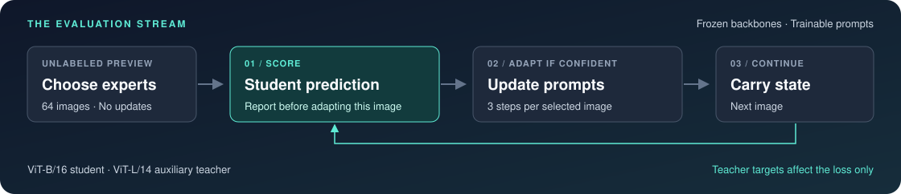

<h1 align="center">MT-TTA</h1>

<p align="center"><strong>Continual CLIP adaptation with shared and private prompt experts</strong></p>
<p align="center">Text + visual prompts · Unlabeled test streams · Student-only predictions</p>

<p align="center">
  <a href="https://github.com/ye1457/MT-TTA/actions/workflows/tests.yml"></a>
  <a href="LICENSE"></a>
  <a href="docs/REPRODUCIBILITY.md"></a>
</p>

<p align="center">
  <a href="#quick-start">Quick start</a> ·
  <a href="#method-and-protocol">Method</a> ·
  <a href="#reference-results">Results</a> ·
  <a href="docs/REPRODUCIBILITY.md">Reproducibility</a> ·
  <a href="#documentation">Documentation</a>
</p>



MT-TTA adapts text and visual prompt experts while keeping the OpenAI CLIP **ViT-B/16 student** and **ViT-L/14 teacher** backbones frozen. Predictions come from the student **before updating on the current image**. The teacher supplies an auxiliary pseudo-label loss; its outputs are never fused into reported predictions.

## Quick start

### 1. Install

The reference environment uses **Python 3.11**, **PyTorch 2.7.1** and **torchvision 0.22.1**, with CUDA 11.8 builds. Formal evaluation requires a CUDA GPU with enough free memory for both backbones and adaptation. CPU-only installation and verification are covered in the [reproducibility guide](docs/REPRODUCIBILITY.md).

```bash
git clone --branch v0.1.2 https://github.com/ye1457/MT-TTA.git
cd MT-TTA
python3.11 -m venv .venv
source .venv/bin/activate
python -m pip install --upgrade pip
python -m pip install torch==2.7.1 torchvision==0.22.1 --index-url https://download.pytorch.org/whl/cu118
python -m pip install -r requirements-runtime.txt
python -m pip install -e .
```

The OpenAI `clip` implementation and tokenizer are bundled. This quick start pins [v0.1.2](https://github.com/ye1457/MT-TTA/tree/v0.1.2); record `git rev-parse HEAD` with your run.

### 2. Prepare data and weights

Follow [data sources, folder layouts and weight downloads](DATA_DEPENDENCIES.md). PACS and OfficeHome require their **complete releases**, with original class folders and filenames. Put the official `ViT-B-16.pt` and `ViT-L-14.pt` files in `models/`; their SHA256 digests are verified before inference. Datasets and weights are obtained separately.

### 3. Validate, then evaluate

For PACS, point to the directory containing `art_painting`, `cartoon`, `photo` and `sketch`:

```bash
PACS_ROOT=/path/to/PACS

# Check layout, counts and ordered image-byte hashes without loading models.
mt-tta-evaluate --benchmark pacs --data-root "$PACS_ROOT" --dry-run --hash-images

# Run the complete seed0 stream on GPU 0.
mt-tta-evaluate --benchmark pacs --data-root "$PACS_ROOT" \
  --model-cache models --gpu 0 --output-dir outputs/pacs_seed0
```

Compare the reported ordered input hashes with the [frozen input references](docs/reference_inputs.json). Use a **new output directory** for every run; runs cannot resume midway.

| Evaluation | Full images | Run instructions |
| :--- | ---: | :--- |
| PACS / OfficeHome | 9,991 / 15,588 | [Shared protocol and commands](docs/REPRODUCIBILITY.md) |
| ImageNet-A / V2 / R / Sketch | 7,500 / 10,000 / 30,000 / 50,889 | [Independent runs and zero-shot controls](docs/IMAGENET_OOD.md) |
| MT-Sketch4-20K | 20,000 | [Frozen membership and assembly](benchmarks/mt_sketch4/README.md) · [evaluation](docs/MT_SKETCH4_EVALUATION.md) |

The custom benchmark includes frozen membership metadata and an assembly tool. Its images must be acquired separately under the four source datasets' terms; the exact subset is defined by that metadata, not by a fresh random sample.

### 4. Read the result

```bash
python -m json.tool outputs/pacs_seed0/summary.json
python -m json.tool outputs/pacs_seed0/completion.json
```

The PACS/OfficeHome summary reports per-domain scores and `macro_top1_percent`; successful completion requires `status: "PASS"`. See the [output fields and result-reading instructions](docs/REPRODUCIBILITY.md).

## Method and protocol

The enabled objective has two terms, both applied to student outputs:

$$\mathcal{L}=\operatorname{CE}(p_s,\hat y_s)+0.08\,\operatorname{CE}(p_s,\hat y_t).$$

The pseudo-labels come from the pre-update student and frozen teacher. A confidence gate selects images for **three AdamW steps**. Shared and private experts provide text and visual prompts; backbone weights remain frozen.

| Protocol choice | PACS / OfficeHome | ImageNet natural shifts | MT-Sketch4-20K |
| :--- | :--- | :--- | :--- |
| Scoring | Seed0, batch1, before update | Same | Same |
| State | Carry prompts across domains; reset optimizers per domain | Initialize independently for each benchmark | Carry prompts and optimizer state across task switches |
| Text routing | First 64 images of each domain | First 64 images of each benchmark | First 64 images per task, all before adaptation |
| Reported branch | PACS: primary; OfficeHome: primary first three domains, text-only shadow for Real_World | Primary | Primary |

Previews are unlabeled, perform no updates, and are later scored once in the formal stream. They are an explicit lookahead budget. PACS/OfficeHome use class-directory/path order; ImageNet uses pinned prompt-name/WNID/path order; the custom benchmark alternates four known tasks. This is source-free adaptation on target streams, with no three-source-domain supervised training.

See [exact PACS/OfficeHome settings](docs/EVALUATION.md), including PACS margin routing versus OfficeHome confidence routing, gates, Clipart learning rate and the independent OfficeHome shadow branch. Entropy, anchor and KL penalties are disabled in the reported configurations.

## Reference results

Full-stream **Top-1 accuracy (%)**, rounded to three decimals:

| Evaluation | PACS | OfficeHome | MT-Sketch4-20K |
| :--- | ---: | ---: | ---: |
| MT-TTA | **98.998** | **86.488** | **60.215** |

| Evaluation | ImageNet-A | ImageNet-V2 | ImageNet-R | ImageNet-Sketch | Equal mean |
| :--- | ---: | ---: | ---: | ---: | ---: |
| Frozen CLIP B/16 | 47.880 | 60.630 | 73.793 | 45.961 | 57.066 |
| MT-TTA | **53.187** | **60.830** | **84.377** | **49.258** | **61.913** |

PACS/OfficeHome scores average the four domains equally; MT-Sketch4 averages its four native classification tasks. See [full results and settings](docs/RESULTS.md) for per-task scores, controls and metric definitions.

## Documentation

| Start here | What it covers |
| :--- | :--- |
| [Reproducibility guide](docs/REPRODUCIBILITY.md) | Environment, commands and result reading |
| [Data and weights](DATA_DEPENDENCIES.md) | Official sources, directory structure, download and hash checks |
| [PACS / OfficeHome protocol](docs/EVALUATION.md) | Ordering, routing, losses, state and shadow branch |
| [ImageNet natural shifts](docs/IMAGENET_OOD.md) | A/V2/R/Sketch, zero-shot controls and four-benchmark reporting |
| [MT-Sketch4 dataset](docs/MT_SKETCH4_DATASET.md) · [evaluation](docs/MT_SKETCH4_EVALUATION.md) | Frozen subset design and native class spaces |
| [Reference results](docs/RESULTS.md) | Per-task metrics and evaluation settings |

<details>
<summary><strong>Repository layout and developer checks</strong></summary>

```text
src/clip_officehome/          Prompt experts, routing, adapters and evaluators
src/clip_officehome/configs/  Fixed configurations and ImageNet class metadata
CLIP/                        Vendored OpenAI CLIP and tokenizer
scripts/                     Data assembly, evaluation and result validation
benchmarks/                  Frozen benchmark membership metadata
tests/                      Protocol, routing and session tests
docs/                        Reproduction guides, protocols and reference results
```

The `clip_officehome` package name is retained across all supported benchmarks. Local data, weights, environments and generated outputs are ignored by Git.

```bash
python -m unittest discover -s tests -v
```

[GitHub Actions](https://github.com/ye1457/MT-TTA/actions/workflows/tests.yml) checks CPU tests, source entrypoints, package builds and installation outside the source tree.

</details>

## License

MT-TTA is released under [MIT](LICENSE). The [OpenAI CLIP](CLIP/LICENSE) and [TPT metadata](licenses/TPT_LICENSE) notices are retained; see [third-party notices](THIRD_PARTY_NOTICES.md). Datasets and pretrained weights retain their own terms.
